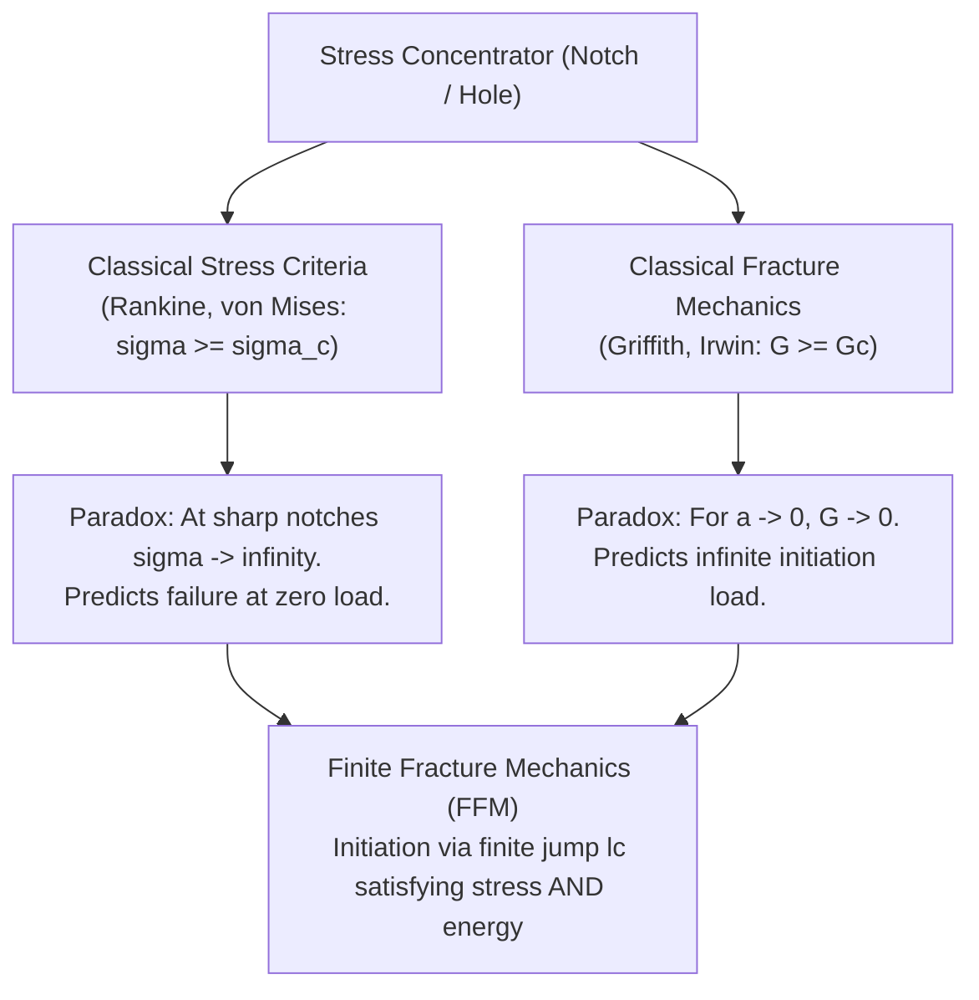

# 01. Overview and Motivation

Navigation: [Wiki Home](../index.md) > [01. Fundamentals](01-introduction.md) > Overview

================================================================================
1. PURPOSE OF FFMCRACKING
================================================================================

FFMcracking is a scientific computational framework written in Python and integrated with Abaqus CAE. Its primary purpose is to quantitatively predict the critical failure load and the finite initiation length of cracks in structural components subjected to stress concentrators where no macro-defect previously existed.

The framework implements the Coupled Criterion (CC) of Finite Fracture Mechanics (FFM), originally formulated by Dominique Leguillon (2002) and extensively analyzed by Garcia (2014) in his doctoral dissertation.

================================================================================
2. THE PHYSICAL DILEMMA OF CRACK INITIATION
================================================================================

In linear elastic solids subjected to geometric stress concentrators (such as open holes, V-notches, reentrant corners, or adhesive joints), traditional structural design methods fail due to two opposing limitations:

2.1. Failure of Classical Pointwise Stress Criteria
--------------------------------------------------------------------------------
Stress criteria (such as Rankine, Tresca, or von Mises) state that failure occurs once local stress reaches material strength (sigma >= sigma_c).
- Physical limitation: At sharp corners or notches, linear elasticity theory predicts a stress singularity (sigma -> inf).
- Erroneous prediction: They predict failure at an infinitesimal load, which strongly contradicts experimental evidence.

2.2. Failure of Linear Elastic Fracture Mechanics (LEFM)
--------------------------------------------------------------------------------
Classical LEFM (Griffith, Irwin) is governed by the energy release rate (G >= Gc). However, it assumes a pre-existing crack.
- Physical limitation: If one assumes infinitesimal crack propagation from an uncracked notch (initial crack length a -> 0), the energy release rate vanishes (G -> 0).
- Erroneous prediction: Under strict LEFM, initiating a crack from an undamaged geometry requires infinite load; cracks would never initiate.

Comparative summary in text:

  [Stress Criteria]  ---> At sharp notches: sigma -> inf ---> Erroneously predicts failure at near-zero load.
  [LEFM (Griffith)]  ---> Without prior crack: G -> 0    ---> Erroneously predicts cracks can never initiate.
  [FFM Coupled Crit] ---> Finite jump of length lc        ---> Correctly predicts realistic failure load and length.

Mermaid Diagram:

================================================================================
3. THE FINITE FRACTURE MECHANICS (FFM) RESOLUTION
================================================================================

Finite Fracture Mechanics resolves both paradoxes through a fundamental postulate: crack initiation is not an infinitesimal continuous process, but a sudden discrete jump of finite size (length lc).

For this finite jump of length lc to occur under a proportional load scaling factor t (or k), two physical conditions must be satisfied SIMULTANEOUSLY:

1. Stress Condition (Necessary Condition):
   Prior to crack onset, normal stress along the prospective crack path must be high enough to overcome atomic cohesive bonds (sigma(x) >= sigma_c throughout the interval).

2. Energy Condition (Sufficient Condition):
   The elastic potential energy released by the body during the jump (-Delta Pi) must be sufficient to supply the fracture surface energy required to create both crack faces (Gc * lc).

================================================================================
4. FFMCRACKING WORKFLOW
================================================================================

FFMcracking executes this methodology in four clear stages:

Stage 1: Continuous Uncracked Simulation (Abaqus)
         Computes the reference stress field in the original geometry and obtains
         the critical stress multiplier t_SC from the minimum normal stress along the path.

Stage 2: Kinematic Crack Insertion and Energy Balance (Abaqus XFEM)
         Represents the crack using XFEM (without cohesive degradation, as an elastic cut)
         and evaluates the reciprocal work RE via Betti's Theorem to obtain t_EC.

Stage 3: Coupled Criterion Evaluation
         Determines the coupled critical multiplier:
         t_CC = max(t_SC, t_EC)

Stage 4: Critical Length Optimization (Optional, Bayesian Engine)
         A Gaussian Process Regression engine finds the length lc that minimizes t_CC(l).

Execution flow in text:

  Input Model (.inp, material, candidate crack)
    |
    +---> 1. Uncracked Simulation  ---> Extract Stresses  ---> Multiplier t_SC
    |
    +---> 2. XFEM Simulation       ---> Betti's Theorem   ---> Multiplier t_EC
    |
    +---> 3. Coupled Criterion: t_CC = max(t_SC, t_EC)
    |
    +---> 4. (Optional) Bayesian Optimization: lc = argmin t_CC(l)

================================================================================
Navigation: [Wiki Home](../index.md) | [Next: Finite Fracture Mechanics](02-finite-fracture-mechanics.md)
================================================================================
