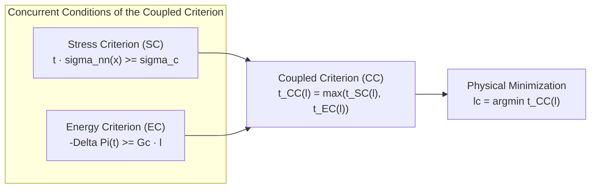

# 02. Finite Fracture Mechanics and Coupled Criterion

Navigation: [Wiki Home](../index.md) > [01. Fundamentals](01-introduction.md) > Finite Fracture Mechanics

================================================================================
1. FORMULATION OF THE COUPLED CRITERION (LEGUILLON, 2002; GARCIA, 2014)
================================================================================

Consider a linear elastic solid subjected to a system of proportional external loads scaled by a positive factor t (also denoted as factor k). Assume the kinematic hypothesis that a straight crack of finite length l suddenly appears along a prescribed path.

The Coupled Criterion (CC) states that crack onset requires the simultaneous fulfillment of two independent conditions:
1. A stress-based condition (Stress Criterion, SC).
2. An energy balance condition (Energy Criterion, EC).

The real physical failure load is the minimum multiplier capable of satisfying both criteria concurrently.

Conceptual diagram in text:

  [Stress Criterion (SC)] ---> t_SC(l) = sigma_c / min(sigma_nn)  (increases with l)
  [Energy Criterion (EC)] ---> t_EC(l) = sqrt(DE / |RE|)           (decreases for small l)
             |                                    |
             +------------------+-----------------+
                                |
                                v
                Coupled Criterion: t_CC(l) = max(t_SC(l), t_EC(l))
                                |
                                v
                Critical onset length: lc = argmin t_CC(l)
                Critical failure load: tc = t_CC(lc)

Mermaid Diagram:

================================================================================
2. STRESS CRITERION (SC)
================================================================================

The stress criterion is evaluated in the uncracked body along the prospective crack path of length l.

2.1. Pointwise Formulation (Implemented in FFMcracking)
--------------------------------------------------------------------------------
Leguillon's formulation requires the normal traction sigma_nn(x) to reach or exceed the tensile strength sigma_c at EVERY point of the candidate path x in [0, l]:

  t * sigma_nn(x) >= sigma_c   for all x in [0, l]

Under proportional loading, the critical stress multiplier is governed by the most critical point (minimum normal stress along the path):

  t_SC(l) = sigma_c / min_{x in [0, l]} (sigma_nn(x))

Formal mathematical notation:
\[
t_{SC}(l) = \frac{\sigma_c}{\min_{x \in [0, l]} \sigma_{nn}(x)}
\]

Monotonic behavior with respect to length l:
Near stress concentrators, normal stress reaches a maximum at the notch root and decreases monotonically into the body. Therefore, as candidate length l increases, min(sigma_nn) decreases strictly. As a direct consequence:
- t_SC(l) is a strictly increasing function of l.
- Longer candidate cracks require higher loads to satisfy the stress condition at their outer tip.

2.2. Average Stress Variant (Cornetti et al., 2006)
--------------------------------------------------------------------------------
An alternative formulation compares tensile strength against average normal stress over the crack segment:
\[
\frac{t}{l} \int_0^l \sigma_{nn}(x) \, dx \ge \sigma_c
\]
While both approaches yield similar results in many practical notched geometries (Garcia, 2014), Leguillon's pointwise criterion is the one currently implemented in FFMcracking due to its conceptual simplicity and direct local formulation.

================================================================================
3. ENERGY CRITERION (EC)
================================================================================

The finite energy balance requires the potential energy decrease (-Delta Pi) during crack formation to equal or exceed the energy needed to form the new fracture surfaces (Delta Gamma):

  -Delta Pi >= Delta Gamma

where Delta Pi = Pi_2 - Pi_1 represents potential energy change between cracked (state 2) and uncracked (state 1) configurations.

3.1. Quadratic Load Scaling and Definition of RE and DE
--------------------------------------------------------------------------------
In linear elasticity under proportional loads, energy release scales quadratically with load factor t:

  -Delta Pi(t) = t^2 * (-Delta Pi(1))

We define two fundamental quantities:
- RE (Reciprocal Energy / Unit energy release):
  RE = -Delta Pi(1)   (energy released under unit load t = 1)
- DE (Dissipated Energy):
  DE = Delta Gamma = Gc * l   (for a 2D planar body of unit thickness, Gc being Mode I fracture toughness)

The critical load multiplier required by energy balance is:

  t_EC(l) = sqrt(DE / |RE|) = sqrt((Gc * l) / |RE|)

Formal notation:
\[
t_{EC}(l) = \sqrt{\frac{DE}{|RE|}} = \sqrt{\frac{G_c \cdot l}{|RE|}}
\]

3.2. Evaluation of RE via Betti's Reciprocal Work Theorem
--------------------------------------------------------------------------------
Rather than integrating strain energy density throughout the entire finite element mesh, FFMcracking applies Betti's Reciprocal Work Theorem (Garcia, 2014, chap. 3). This evaluates RE using only boundary nodal forces and displacements:

  RE = 0.5 * sum_{i in BCs} [ Ux2(i)*Fx1(i) + Uy2(i)*Fy1(i) - Ux1(i)*Fx2(i) - Uy1(i)*Fy2(i) ]

where:
- Subscript 1: Uncracked state (-without.odb).
- Subscript 2: Cracked state (-with.odb).

Behavior with respect to length l:
- For very short cracks (l -> 0), released energy RE scales as l^2 (or steeper). Consequently, DE / RE -> infinity as l -> 0, causing t_EC to diverge for very short lengths.
- For longer lengths, t_EC decreases rapidly to a minimum before rising with a mild slope.

================================================================================
4. COUPLING AND CRITICAL LENGTH lc
================================================================================

For any candidate length l, the multiplier required to satisfy both criteria simultaneously is:

  t_CC(l) = max(t_SC(l), t_EC(l))

Since the structure fails under the lowest possible load that satisfies the underlying physics, the critical initiation length lc and failure load tc are given by:

  lc = argmin_{l > 0} t_CC(l)
  tc = t_CC(lc)

ASCII curve representation:

  Factor t
     ^
     | \  t_EC(l) (Energy Criterion)
     |  \                         /  t_SC(l) (Stress Criterion)
     |   \                       /
     |    \                     /
     |     \                   /
  tc |......\________*________/  <--- t_CC(l) = max(t_SC, t_EC)
     |                |
     |                | (Optimum point: t_SC = t_EC)
     +----------------+--------------------> Length l
     0               lc

Physical regions:
1. Region l < lc (Energy-dominated):
   Although average stress is high near the notch, insufficient strain energy is released. t_EC > t_SC; the crack cannot initiate at such short lengths.
2. Region l > lc (Stress-dominated):
   Energy is abundant, but normal stress at the far tip falls below tensile strength sigma_c. t_SC > t_EC; the crack cannot reach that length without higher load.
3. Critical length lc:
   The physical initiation length predicted by Finite Fracture Mechanics. In monotonic problems, it corresponds to the exact intersection:
   t_SC(lc) = t_EC(lc)

================================================================================
5. CHARACTERISTIC LENGTH AND BRITTLENESS NUMBER
================================================================================

As established in Garcia (2014, section 3.5), Finite Fracture Mechanics defines an intrinsic characteristic material length:

  l_ch = (E * Gc) / (sigma_c^2)

From this length and the characteristic structural dimension L, the dimensionless brittleness number gamma is defined:

  gamma = (1 / sigma_c) * sqrt((Gc * E) / L) = sqrt(l_ch / L)

This governs the structural failure regime:
- gamma >> 1 (Small or very brittle components):
  The energy criterion dominates; behavior approaches Linear Elastic Fracture Mechanics (LEFM).
- gamma << 1 (Large components or high-toughness materials):
  The stress criterion dominates; critical load approaches traditional yield or strength limits.
- gamma approx 1:
  Strong coupling regime where both criteria interact, and FFMcracking is essential.

================================================================================
Navigation: [Previous: Overview](01-introduction.md) | [Wiki Home](../index.md) | [Next: System Design](../02-architecture/01-system-design.md)
================================================================================
