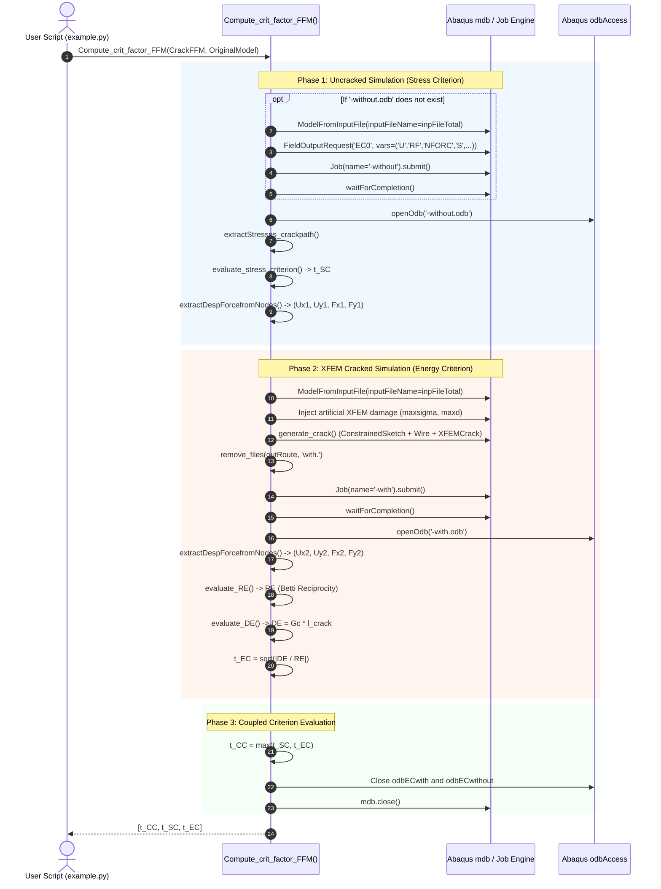

# 02. Simulation Lifecycle in Abaqus

Navigation: [Wiki Home](../index.md) > [02. Architecture](01-system-design.md) > Simulation Lifecycle

================================================================================
1. DUAL SIMULATION LIFECYCLE
================================================================================

To evaluate the Coupled Criterion on any candidate crack, FFMcracking sequentially manages two independent Abaqus finite element simulations:

1. Continuous Elastic Simulation (Uncracked):
   - Generates job `<jobName>-without`.
   - Produces output database `<jobName>-without.odb`.
   - Computes stress fields for the Stress Criterion (SC) and boundary nodal forces/displacements (State 1).

2. Kinematic XFEM Simulation (Cracked):
   - Generates job `<jobName>-with`.
   - Produces output database `<jobName>-with.odb`.
   - Evaluates boundary nodal forces and displacements after crack opening (State 2).

Sequence diagram in text:

  User Script (example.py)
       |
       |--- 1. Calls Compute_crit_factor_FFM(CrackFFM, OriginalModel)
       |
       +---> [PHASE 1: Uncracked Model]
       |     |
       |     |-- Does <job>-without.odb exist in outRoute?
       |     |   NO: Import .inp, create FieldOutputRequest 'EC0', submit Job '-without'
       |     |   YES: Reuse existing .odb (Caching Strategy)
       |     |
       |     |-- Open <job>-without.odb
       |     |-- Extract crack path stresses -> t_SC
       |     +-- Read U and F at boundary nodes -> (Ux1, Uy1, Fx1, Fy1)
       |
       +---> [PHASE 2: XFEM Cracked Model]
       |     |
       |     |-- Import .inp into fresh mdb
       |     |-- Configure material with artificial XFEM threshold (maxsigma)
       |     |-- generate_crack(): creates Wire and XFEMCrack engineering feature
       |     |-- Submit Job '-with' -> produces <job>-with.odb
       |     |-- Read U and F at boundary nodes -> (Ux2, Uy2, Fx2, Fy2)
       |     |-- Compute RE via Betti's Reciprocal Theorem
       |     |-- Compute DE = Gc * l
       |     +-- Compute t_EC = sqrt(DE / |RE|)
       |
       +---> [PHASE 3: Coupling and Cleanup]
       |     |
       |     |-- t_CC = max(t_SC, t_EC)
       |     |-- Close databases odbECwith and odbECwithout
       |     +-- Close mdb model (mdb.close())
       |
       v
  Returns [t_CC, t_SC, t_EC]

Mermaid Diagram:


================================================================================
2. UNCRACKED MODEL CACHING STRATEGY
================================================================================

A key performance optimization in FFMcracking is the automatic reuse of the continuous baseline model.

See `src/FFMcracking.py`:
```python
if jobNameEC + '-without.odb' not in os.listdir(outRoute):
    # Solves and creates the uncracked job
```

Physical justification:
Stress and displacement fields in the uncracked body depend exclusively on the original `.inp` geometry, boundary conditions, and loads. They are INDEPENDENT of candidate crack length l.

Performance impact:
During a 15-evaluation Bayesian optimization run, the uncracked model runs exactly once. The remaining 14 iterations read `-without.odb` directly from disk, saving approximately 50% CPU time per evaluation.

================================================================================
3. RESOURCE AND FILE MANAGEMENT
================================================================================

During iterative execution, Abaqus creates multiple scratch files (.lck, .prt, .fil, .msg, .sta, .ipm).

To prevent lock collisions and disk saturation:
1. File purging:
   Before submitting each cracked job, `remove_files(outRoute, 'with.')` cleans up prior iteration files.
2. Explicit database closing:
   All ODB pointers (`odbECwithout.close()`, `odbECwith.close()`) and the model database (`mdb.close()`) are explicitly closed. This releases file system descriptors and prevents residual lock files (.lck).

================================================================================
Navigation: [Previous: System Design](01-system-design.md) | [Wiki Home](../index.md) | [Next: FFMcracking Module](../03-modules/01-module-ffmcracking.md)
================================================================================
