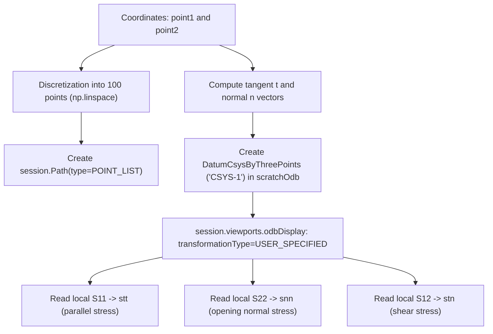

# 02. Stress Extraction and SC

Navigation: [Wiki Home](../index.md) > [03. Modules](01-module-ffmcracking.md) > Stress Extraction and SC

================================================================================
1. PROCESS OVERVIEW
================================================================================

To evaluate the Stress Criterion (SC) in the uncracked body, local stress components must be sampled along the prospective crack path and projected normally to crack faces.

This is executed by two functions:
1. `extractStresses_crackpath(session, odbObject, CrackFFM)`:
   Extracts endpoints from `CrackFFM` and delegates reading to `extractStressesBetween2points()`.
2. `extractStressesBetween2points(session, odbObject, point1, point2)`:
   Builds a spatial path (`session.Path`), creates a local orthogonal coordinate system (`CSYS-1`), and extracts projected stress components.

Process flowchart in text:

  point1, point2 (Crack endpoints)
        |
        v
  Discretization into 100 equidistant points (np.linspace)
        |
        v
  Creation of Abaqus path: session.Path(type=POINT_LIST)
        |
        v
  Calculation of tangent (t) and normal (n) unit vectors
        |
        v
  Creation of local coordinate system 'CSYS-1' in scratchOdb
        |
        v
  Stress tensor transformation (transformationType=USER_SPECIFIED)
        |
        v
  Component extraction via session.XYDataFromPath:
    - S11 local: stress parallel to crack (stt)
    - S22 local: opening normal stress (snn)
    - S12 local: in-plane shear stress (stn)

Mermaid Diagram:


================================================================================
2. LOCAL COORDINATE SYSTEM AND PROJECTION
================================================================================

Candidate cracks may be oriented at arbitrary angles relative to global axes (X, Y). Evaluating Mode I opening requires the normal traction component:

1. Local Orthonormal Basis:
   From endpoints `point1` and `point2`, unit basis vectors are:
   - Tangent unit vector:
     t_vector = (p2 - p1) / ||p2 - p1||
   - Normal unit vector:
     n_vector = (-t_y, t_x, 0.0)

2. 'CSYS-1' System:
   In `scratchOdb`, Abaqus builds a datum coordinate system from three points: origin (`point1`), a point along axis 1 (`point2`), and a director point on the normal plane.

3. Viewport Transformation:
   Setting `transformationType=USER_SPECIFIED` pointing to `CSYS-1` extracts:
   - S11: Stress parallel to crack.
   - S22: Stress perpendicular to crack (sigma_nn, governing Mode I opening).
   - S12: In-plane shear stress (sigma_tn).

================================================================================
3. STRESS CRITERION EVALUATION: evaluate_stress_criterion
================================================================================

The function `evaluate_stress_criterion(stresses, sigmac)` processes the extracted stresses and material tensile strength `sigmac`.

Mathematical logic:
1. Filters data for the target step.
2. Identifies the normal stress series `snn` (local S22).
3. Evaluates the pointwise critical multiplier:

   t_SC = sigmac / min(snn)

Technical observation on original implementation:
The original source code checks:
```python
if np.max(snn) > 0:
    k_sc = sigmac / np.min(snn)
```
If the candidate crack path extends into a compression region, `min(snn)` is negative, yielding a non-physical negative `t_SC`. A rigorous pointwise criterion requires `min(snn) > 0` over the entire crack length. If `min(snn) <= 0`, the crack path exceeds the tension zone and pure Mode I onset cannot occur at that length.

================================================================================
Navigation: [Previous: Central Module](01-module-ffmcracking.md) | [Wiki Home](../index.md) | [Next: XFEM and Energy Criterion](03-xfem-method-and-energy.md)
================================================================================
