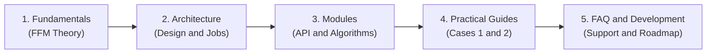

# FFMcracking Wiki — Technical Documentation

Computational framework for crack initiation prediction in Abaqus CAE using the Coupled Criterion of Finite Fracture Mechanics (Leguillon, 2002; Garcia, 2014) and Bayesian Optimization.

================================================================================
1. WIKI NAVIGATION MAP
================================================================================

The documentation is organized in a modular structure to guide simulation users, engineers, and researchers extending the framework:

Recommended reading path:
  [1. Fundamentals] ---> [2. Architecture] ---> [3. Modules] ---> [4. Practical Guides] ---> [5. FAQ & Development]

Mermaid Diagram:

================================================================================
2. TOPICAL STRUCTURE AND CONTENTS
================================================================================

2.1. THEORETICAL FUNDAMENTALS (wiki/en/01-fundamentals/)
--------------------------------------------------------------------------------
- 01. Overview and Motivation (01-introduction.md)
  Limitations of classical stress criteria and Linear Elastic Fracture Mechanics (LEFM). Resolution of stress concentrator paradoxes via the finite jump hypothesis.
- 02. Finite Fracture Mechanics and Coupled Criterion (02-finite-fracture-mechanics.md)
  Complete mathematical formulation of the Coupled Criterion (CC): Stress Criterion (SC), Energy Criterion (EC) via Betti's Reciprocal Work Theorem, min-max coupling, and critical length lc determination.

2.2. SYSTEM ARCHITECTURE (wiki/en/02-architecture/)
--------------------------------------------------------------------------------
- 01. General System Design (01-system-design.md)
  Layered architecture: Application Layer, Bayesian Optimization Layer, FFM Solver Layer, and Abaqus CAE Simulation Kernel.
- 02. Simulation Lifecycle in Abaqus (02-simulation-lifecycle.md)
  Dual simulation lifecycle: continuous elastic job (-without.odb), kinematic crack insertion with XFEM (-with.odb), and baseline model caching strategy.

2.3. MODULES TECHNICAL REFERENCE (wiki/en/03-modules/)
--------------------------------------------------------------------------------
- 01. Central Module: FFMcracking (01-module-ffmcracking.md)
  Data classes (FFM_Material, FFM_Crack, FFM_InputModel), orchestrator function Compute_crit_factor_FFM, and job file management.
- 02. Stress Extraction and SC (02-stress-extraction.md)
  Spatial discretization along crack paths (Path), local orthogonal coordinate systems (CSYS-1), stress tensor projection, and pointwise k_SC evaluation.
- 03. XFEM Modeling and EC (03-xfem-method-and-energy.md)
  XFEM as a non-cohesive geometric separator, evaluation of reciprocal work RE (Betti), and dissipated energy DE = Gc * lc.
- 04. Bayesian Optimization Module (04-optimization-module.md)
  Gaussian Process Regression (GPR), RBF kernel, Expected Improvement (EI) acquisition function, and zero-external-dependency implementation.

2.4. PRACTICAL GUIDES AND TUTORIALS (wiki/en/04-guides-and-examples/)
--------------------------------------------------------------------------------
- 01. Requirements and Setup (01-requirements-and-setup.md)
  Abaqus environment prerequisites (2020+), PYTHONPATH setup, and run directory structure.
- 02. Example 1: Fixed Crack (02-example-1-fixed-crack.md)
  Direct critical load factor calculation for a predetermined crack geometry in an open-hole plate (sample1).
- 03. Example 2: Length Optimization (03-example-2-length-optimization.md)
  Autonomous Bayesian search for the critical crack initiation length lc and structural failure load (sample2).

2.5. SUPPORT, FAQ, AND DEVELOPMENT (wiki/en/05-faq-and-development/)
--------------------------------------------------------------------------------
- 01. Troubleshooting and FAQ (01-troubleshooting-faq.md)
  Handling lock files (.lck), numerical convergence, stress sign issues, and Abaqus debugging tips.
- 02. Developer Guide and Roadmap (02-development-and-extensions.md)
  Code standards, Python 2/3 compatibility, mixed-mode failure extensions, and bimaterial interface formulation.

================================================================================
> [NOTE]
> First-time users are recommended to start with 01-fundamentals/01-introduction.md
> to understand the underlying mechanics, followed by 04-guides-and-examples/01-requirements-and-setup.md.
================================================================================
