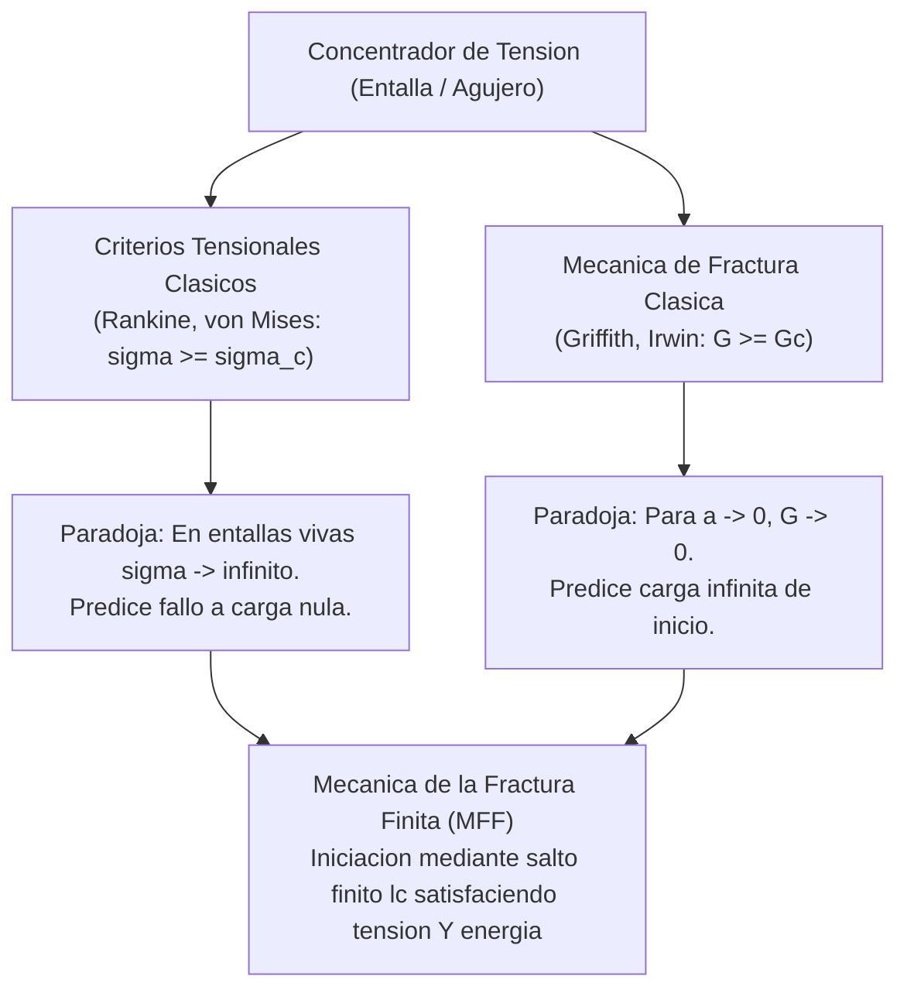

# 01. Vision General y Motivacion

Navegacion: [Portada Wiki](../index.md) > [01. Fundamentos](01-introduccion.md) > Vision General

================================================================================
1. PROPOSITO DE FFMCRACKING
================================================================================

FFMcracking es un entorno de calculo cientifico desarrollado en Python e integrado con Abaqus CAE. Su objetivo principal es resolver un problema critico en ingenieria estructural: predecir de forma cuantitativa la carga critica de rotura y la longitud finita con la que aparece una grieta en puntos donde previamente no existia ninguna discontinuidad macroscopica.

El programa implementa el Criterio Acoplado (CA) de la Mecanica de la Fractura Finita (MFF), formulado originalmente por Dominique Leguillon (2002) y desarrollado en profundidad por Garcia (2014) en su tesis doctoral.

================================================================================
2. EL PROBLEMA FISICO DE LA INICIACION DE GRIETAS
================================================================================

En solidos elasticos lineales sometidos a concentradores geometricos de tension (tales como agujeros, entallas en V, esquinas reentrantes o uniones adhesivas), los metodos tradicionales de diseno fallan por dos motivos opuestos:

2.1. Fallo de los criterios tensionales clasicos
--------------------------------------------------------------------------------
Los criterios basados unicamente en tensiones locales (como Rankine, Tresca o von Mises) postulan que el material rompe si la tension en algun punto alcanza la resistencia limite (sigma >= sigma_c).
- Limitacion fisica: En esquinas vivas o entallas afiladas, la teoria elastica lineal predice una singularidad tensional donde la tension teorica tiende a infinito (sigma -> inf).
- Consecuencia erronea: Predecirian que la pieza rompe bajo cualquier carga infinitesimal, lo cual contradice frontalmente la experiencia experimental.

2.2. Fallo de la Mecanica de la Fractura Elastica Lineal (MFEL)
--------------------------------------------------------------------------------
La MFEL clasica (teoria de Griffith e Irwin) se basa en la tasa de liberacion de energia (G >= Gc). Sin embargo, fue concebida para estudiar el *crecimiento* de una grieta preexistente, no su *iniciacion*.
- Limitacion fisica: Si se asume un crecimiento infinitesimal desde un concentrador sin grieta previa (longitud inicial a -> 0), la tasa de liberacion de energia tiende a cero (G -> 0).
- Consecuencia erronea: Segun la MFEL estricta, la carga necesaria para iniciar una grieta infinitesimal tenderia a infinito; la grieta nunca podria nacer.

Esquema comparativo del problema:

  [Criterios Tensionales]  --->  En entalla viva: sigma -> inf  --->  Predice rotura con carga casi nula (erroneo).
  [MFEL Clasica (Griffith)] --->  Sin grieta: G -> 0            --->  Predice que nunca se inicia grieta (erroneo).
  [MFF Criterio Acoplado]  --->  Salto finito de longitud lc    --->  Predice carga critica real y longitud (correcto).

Diagrama Mermaid:

================================================================================
3. LA RESPUESTA DE LA MECANICA DE LA FRACTURA FINITA (MFF)
================================================================================

La Mecanica de la Fractura Finita supera ambas paradojas mediante una hipotesis fundamental: la iniciacion de una grieta no es un proceso infinitesimal continuo, sino un salto discreto y simultaneo de tamano finito (longitud lc).

Para que se produzca este salto finito de longitud lc a un factor de carga multiplicador t (o k), deben cumplirse SIMULTANEAMENTE dos condiciones fisicas:

1. Condicion Tensional (Condicion Necesaria):
   Antes de que se forme la grieta, el estado tensional debe ser suficientemente severo en todo el trayecto de la futura rotura para vencer la resistencia de cohesion del material (sigma(x) >= sigma_c en todo el intervalo).

2. Condicion Energetica (Condicion Suficiente):
   La energia potencial elastica liberada por la pieza al formarse la grieta de golpe (-Delta Pi) debe ser suficiente para suministrar la energia superficial requerida para crear las dos nuevas caras de la fractura (Gc * lc).

================================================================================
4. FLUJO DE TRABAJO EN FFMCRACKING
================================================================================

El framework FFMcracking articula este proceso en cuatro etapas principales:

Paso 1: Simulacion continua sin grieta (Abaqus)
        Calcula el campo de tensiones en el modelo original y obtiene el
        multiplicador critico t_SC a partir de la tension normal minima en la ruta.

Paso 2: Insercion cinematica de grieta y calculo energetico (Abaqus XFEM)
        Modela la grieta mediante XFEM (sin daño cohesivo, como discontinuidad elastica)
        y calcula el trabajo reciproco RE mediante el Teorema de Betti para obtener t_EC.

Paso 3: Evaluacion del Criterio Acoplado
        Determina el factor de carga critico combinado:
        t_CC = max(t_SC, t_EC)

Paso 4: Optimizacion de la longitud critica (Opcional, en optimizacion)
        Un modulo de Procesos Gaussianos busca el valor de lc que minimiza t_CC(l).

Esquema de flujo de ejecucion:

  Entrada (.inp, material, grieta candidata)
    |
    +---> 1. Simulacion sin grieta  ---> Extraer tensiones  ---> Factor t_SC
    |
    +---> 2. Simulacion con XFEM    ---> Teorema de Betti   ---> Factor t_EC
    |
    +---> 3. Criterio Acoplado: t_CC = max(t_SC, t_EC)
    |
    +---> 4. (Opcional) Optimizacion Bayesiana: lc = argmin t_CC(l)

================================================================================
Navegacion: [Portada Wiki](../index.md) | [Siguiente: Mecanica de Fractura Finita](02-mecanica-fractura-finita.md)
================================================================================
