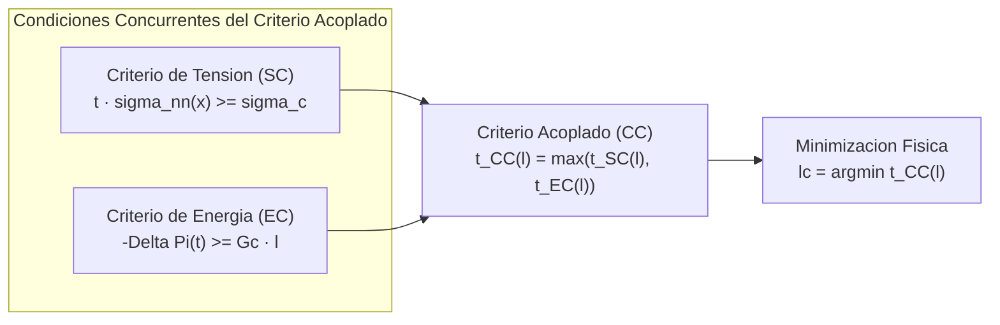

# 02. Mecanica de Fractura Finita y Criterio Acoplado

Navegacion: [Portada Wiki](../index.md) > [01. Fundamentos](01-introduccion.md) > Mecanica de Fractura Finita

================================================================================
1. FORMULACION DEL CRITERIO ACOPLADO (LEGUILLON, 2002; GARCIA, 2014)
================================================================================

Considerese un solido elastico lineal sometido a un sistema de cargas proporcionales escaladas por un factor positivo t (denotado tambien como factor k). Supongase la hipotesis cinematica de que se forma de manera subita una grieta plana de longitud finita l a lo largo de un camino predeterminado.

El Criterio Acoplado (CA) establece que la iniciacion de dicha grieta requiere la satisfaccion simultanea de dos condiciones independientes:
1. Una condicion basada en tensiones (Criterio Tensional, SC).
2. Una condicion basada en el balance energetico (Criterio Energetico, EC).

La carga critica real sera el minimo factor de carga capaz de verificar ambas condiciones concurrentemente.

Diagrama conceptual en texto:

  [Criterio de Tension (SC)] ---> t_SC(l) = sigma_c / min(sigma_nn)  (crece con l)
  [Criterio de Energia (EC)] ---> t_EC(l) = sqrt(DE / |RE|)           (decrece para l pequenas)
             |                                    |
             +------------------+-----------------+
                                |
                                v
                Criterio Acoplado: t_CC(l) = max(t_SC(l), t_EC(l))
                                |
                                v
                Longitud critica de inicio: lc = argmin t_CC(l)
                Factor critico de rotura:   tc = t_CC(lc)

Diagrama Mermaid:

================================================================================
2. CRITERIO TENSIONAL (STRESS CRITERION, SC)
================================================================================

El criterio tensional se evalua en el solido ORIGINAL (sin grieta) a lo largo del segmento de longitud l donde potencialmente se abrira la fisura.

2.1. Formulacion puntual (implementada en FFMcracking)
--------------------------------------------------------------------------------
La formulacion de Leguillon exige que la traccion normal sigma_nn(x) iguale o supere la resistencia a traccion del material sigma_c en TODOS los puntos del camino candidato x en [0, l]:

  t * sigma_nn(x) >= sigma_c   para todo x en [0, l]

Dado que las cargas escalan linealmente con el factor t, el multiplicador critico del criterio tensional viene fijado por el punto mas desfavorecido (el valor minimo de tension normal en dicho trayecto):

  t_SC(l) = sigma_c / min_{x en [0, l]} (sigma_nn(x))

En notacion matematica formal:
\[
t_{SC}(l) = \frac{\sigma_c}{\min_{x \in [0, l]} \sigma_{nn}(x)}
\]

Comportamiento respecto a la longitud l:
En concentradores de tension, la tension normal maxima se alcanza en el borde de la entalla y decae monotona y rapidamente hacia el interior del solido. Por tanto, al aumentar la longitud l, el valor de min(sigma_nn) disminuye estrictamente. Como consecuencia directa:
- t_SC(l) es una funcion estrictamente creciente con respecto a l.
- A mayor tamano de grieta candidata, mayor es la carga necesaria para satisfacer la condicion tensional en su vertice exterior.

2.2. Variante promediada (Cornetti et al., 2006)
--------------------------------------------------------------------------------
Una formulacion alternativa compara la resistencia con el valor promedio de la tension a lo largo del segmento:
\[
\frac{t}{l} \int_0^l \sigma_{nn}(x) \, dx \ge \sigma_c
\]
Aunque ambas formulaciones arrojan resultados cuantitativamente proximos en la mayoria de aplicaciones practicas (Garcia, 2014), la formulacion puntual de Leguillon es la implementada actualmente en FFMcracking por su sencillez y solidez conceptual.

================================================================================
3. CRITERIO ENERGETICO (ENERGY CRITERION, EC)
================================================================================

El balance de energia para un avance finito de grieta establece que la disminucion de energia potencial elastica total del sistema (-Delta Pi) debe ser suficiente para satisfacer la energia requerida en la creacion de la nueva superficie de fractura (Delta Gamma):

  -Delta Pi >= Delta Gamma

donde Delta Pi = Pi_2 - Pi_1 representa la variacion de energia potencial entre el estado final con grieta (estado 2) y el estado inicial continuo (estado 1).

3.1. Escala con la carga y definicion de RE y DE
--------------------------------------------------------------------------------
En un material elastico lineal bajo cargas proporcionales, la energia liberada escala con el cuadrado del factor de carga t:

  -Delta Pi(t) = t^2 * (-Delta Pi(1))

Se definen dos magnitudes fundamentales:
- RE (Reciprocal Energy / Energia liberada unitaria):
  RE = -Delta Pi(1)   (energia liberada evaluada a factor de carga unitario t = 1)
- DE (Dissipated Energy / Energia disipada requerida):
  DE = Delta Gamma = Gc * l   (para un solido plano de espesor unitario, donde Gc es la tenacidad de fractura en Modo I)

El multiplicador de carga critico exigido por el balance de energia resulta:

  t_EC(l) = sqrt(DE / |RE|) = sqrt((Gc * l) / |RE|)

En notacion formal:
\[
t_{EC}(l) = \sqrt{\frac{DE}{|RE|}} = \sqrt{\frac{G_c \cdot l}{|RE|}}
\]

3.2. Evaluacion de RE mediante el Teorema del Trabajo Reciproco de Betti
--------------------------------------------------------------------------------
En lugar de integrar densidades de energia de deformacion sobre toda la malla de elementos finitos, FFMcracking aplica el Teorema de Reciprocidad de Betti (Garcia, 2014, cap. 3). Esto permite calcular RE de forma exacta evaluando unicamente fuerzas nodales y desplazamientos en el contorno con condiciones de contorno (BCs):

  RE = 0.5 * sum_{i en BCs} [ Ux2(i)*Fx1(i) + Uy2(i)*Fy1(i) - Ux1(i)*Fx2(i) - Uy1(i)*Fy2(i) ]

donde:
- Subindice 1: valores del estado sin grieta (obtenidos del trabajo -without.odb).
- Subindice 2: valores del estado con grieta (obtenidos del trabajo -with.odb).

Comportamiento respecto a la longitud l:
- Para grietas infinitesimales (l -> 0), la energia liberada RE tiende a cero mas rapido que la longitud (en entallas lisas RE crece tipicamente como l^2). En consecuencia, DE / RE -> infinito cuando l -> 0, por lo que t_EC tiende a infinito para longitudes muy cortas.
- Para longitudes mayores, t_EC disminuye bruscamente y alcanza un minimo antes de volver a crecer con pendientes suaves.

================================================================================
4. ACOPLAMIENTO Y DETERMINACION DE LA LONGITUD CRITICA lc
================================================================================

Para cualquier longitud candidata l, el factor de carga necesario para que se cumplan ambas condiciones a la vez viene dado por el maximo:

  t_CC(l) = max(t_SC(l), t_EC(l))

Dado que el solido rompera bajo la carga mas baja posible que satisfaga la fisica del problema, la longitud critica con la que la grieta aparece instantaneamente (lc) y la carga critica de rotura (tc) vienen dadas por la minimizacion:

  lc = argmin_{l > 0} t_CC(l)
  tc = t_CC(lc)

Representacion grafica en texto:

  Factor t
     ^
     | \  t_EC(l) (Criterio Energia)
     |  \                         /  t_SC(l) (Criterio Tension)
     |   \                       /
     |    \                     /
     |     \                   /
  tc |......\________*________/  <--- t_CC(l) = max(t_SC, t_EC)
     |                |
     |                | (Punto optimo: t_SC = t_EC)
     +----------------+--------------------> Longitud l
     0               lc

Interpretacion por regiones:
1. Region l < lc (dominada por energia):
   Aunque la tension media es muy alta cerca de la entalla (t_SC bajo), la pieza no tiene suficiente energia elastica para formar la superficie de grieta. t_EC > t_SC; la rotura no puede ocurrir con una longitud tan pequena.
2. Region l > lc (dominada por tension):
   Hay energia disponible de sobra para crear la grieta, pero la tension normal en el extremo alejado es inferior a la resistencia sigma_c. t_SC > t_EC; la rotura no puede extenderse hasta alli sin aumentar la carga exterior.
3. Longitud critica lc:
   Es el tamano exacto del salto instantaneo de fractura predicho por la Mecanica de la Fractura Finita. En problemas con tension monotona, coincide con el punto de corte exacto:
   t_SC(lc) = t_EC(lc)

================================================================================
5. LONGITUD CARACTERISTICA Y NUMERO DE FRAGILIDAD
================================================================================

Segun se fundamenta en la tesis de Garcia (2014, seccion 3.5), la Mecanica de la Fractura Finita introduce de manera natural una longitud caracteristica del material:

  l_ch = (E * Gc) / (sigma_c^2)

donde E es el modulo de Young, Gc la tenacidad y sigma_c la resistencia a traccion.

A partir de esta longitud y de la dimension caracteristica del componente estructural L, se define el numero de fragilidad adimensional gamma:

  gamma = (1 / sigma_c) * sqrt((Gc * E) / L) = sqrt(l_ch / L)

Este numero gobierna el regimen de fallo del componente:
- gamma >> 1 (Componentes pequenos o muy fragiles):
  El criterio energetico domina sobre casi todo el rango; el comportamiento se aproxima a la Mecanica de Fractura Lineal (MFEL).
- gamma << 1 (Componentes grandes o materiales de alta tenacidad):
  El criterio tensional domina; la carga critica se aproxima a los limites convencionales de resistencia elastica o plastico.
- gamma approx 1:
  Regimen intermedio de acoplamiento fuerte, donde ninguna de las dos teorias clasicas por separado es capaz de predecir la rotura y el uso de FFMcracking resulta indispensable.

================================================================================
Navegacion: [Anterior: Vision General](01-introduccion.md) | [Portada Wiki](../index.md) | [Siguiente: Diseno General](../02-arquitectura/01-diseno-general.md)
================================================================================
