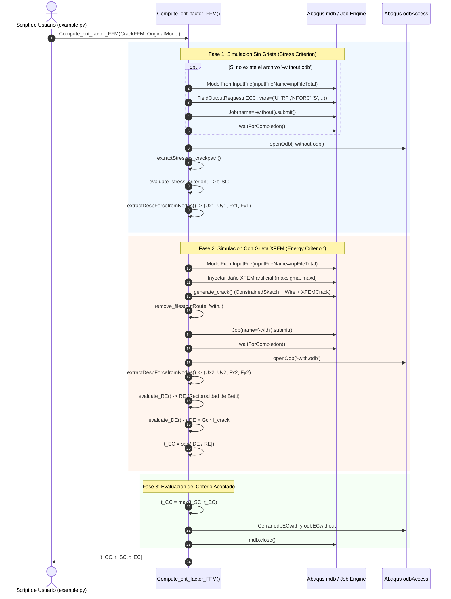

# 02. Ciclo de Simulacion en Abaqus

Navegacion: [Portada Wiki](../index.md) > [02. Arquitectura](01-diseno-general.md) > Ciclo de Simulacion

================================================================================
1. CICLO DE VIDA DUAL DE SIMULACION
================================================================================

Para evaluar el Criterio Acoplado sobre una grieta candidata, FFMcracking gestiona de forma secuencial dos modelos y simulaciones independientes en Abaqus:

1. Simulacion Elastica Continua (Sin Grieta):
   - Genera el trabajo `<jobName>-without`.
   - Produce el archivo de resultados `<jobName>-without.odb`.
   - Proporciona el campo de tensiones para evaluar el Criterio de Tension (SC) y las fuerzas/desplazamientos nodales iniciales del contorno (Estado 1).

2. Simulacion con Grieta Cinematica XFEM (Con Grieta):
   - Genera el trabajo `<jobName>-with`.
   - Produce el archivo de resultados `<jobName>-with.odb`.
   - Proporciona las fuerzas y desplazamientos nodales del contorno tras la apertura elastica de la fisura (Estado 2).

Diagrama de secuencia en texto:

  Script Usuario (example.py)
       |
       |--- 1. Llama a Compute_crit_factor_FFM(CrackFFM, OriginalModel)
       |
       +---> [FASE 1: Modelo Sin Grieta]
       |     |
       |     |-- ¿Existe <job>-without.odb en outRoute?
       |     |   NO: Importa .inp, crea FieldOutputRequest 'EC0', lanza Job '-without'
       |     |   SI: Reutiliza el .odb existente (Estrategia de Cache)
       |     |
       |     |-- Abre <job>-without.odb
       |     |-- Extrae tensiones en el camino de grieta -> t_SC
       |     +-- Lee U y F en nodos de contorno -> (Ux1, Uy1, Fx1, Fy1)
       |
       +---> [FASE 2: Modelo Con Grieta XFEM]
       |     |
       |     |-- Importa .inp nuevamente en mdb
       |     |-- Configura material con daño XFEM artificial inactivo (maxsigma)
       |     |-- generate_crack(): crea Wire y feature XFEMCrack
       |     |-- Pesa y lanza Job '-with' -> genera <job>-with.odb
       |     |-- Lee U y F en nodos de contorno -> (Ux2, Uy2, Fx2, Fy2)
       |     |-- Calcula RE mediante Teorema de Betti
       |     |-- Calcula DE = Gc * l
       |     +-- Obtiene t_EC = sqrt(DE / |RE|)
       |
       +---> [FASE 3: Evaluacion y Cierre]
       |     |
       |     |-- t_CC = max(t_SC, t_EC)
       |     |-- Cierra bases de datos odbECwith y odbECwithout
       |     +-- Cierra base mdb (mdb.close())
       |
       v
  Retorna [t_CC, t_SC, t_EC]

Diagrama Mermaid:


================================================================================
2. ESTRATEGIA DE CACHE DEL MODELO SIN GRIETA
================================================================================

Uno de los aspectos mas eficientes del diseno de FFMcracking es la reutilizacion automatica del calculo continuo sin grieta.

Observese la comprobacion en `src/FFMcracking.py`:
```python
if jobNameEC + '-without.odb' not in os.listdir(outRoute):
    # Genera y lanza el trabajo sin grieta
```

Fundamento fisico:
El estado tensional y los desplazamientos de la probeta sin grieta dependen exclusivamente de la geometria inicial, las condiciones de contorno y las cargas prescritas en el archivo `.inp`. Dicho estado es totalmente INDEPENDIENTE de la longitud hipotetica de grieta l que se evalue.

Impacto en el rendimiento:
Durante una optimizacion Bayesiana de 15 evaluaciones, el calculo sin grieta se ejecuta estrictamente una vez (en la primera iteracion). En las 14 iteraciones restantes, el archivo `-without.odb` se abre directamente de disco en modo lectura, ahorrando aproximadamente el 50% del coste de CPU de cada iteracion.

================================================================================
3. CONTROL DE RECURSOS Y LIMPIEZA DE FICHEROS
================================================================================

Durante la ejecucion iterativa, Abaqus genera numerosos ficheros temporales por cada job (.lck, .prt, .fil, .msg, .sta, .ipm).

Para evitar colisiones de ficheros bloqueados o saturacion de espacio en disco:
1. Purgado de ficheros previos:
   Antes de compilar y lanzar el trabajo con grieta, la funcion `remove_files(outRoute, 'with.')` elimina los artefactos del paso anterior.
2. Cierre explicito de bases de datos:
   Al concluir el calculo, se cierran formalmente los punteros ODB (`odbECwithout.close()`, `odbECwith.close()`) y la base de datos de modelos activa (`mdb.close()`). Esto libera los descriptores de fichero del sistema operativo y previene la aparicion de archivos de bloqueo residuales (.lck).

================================================================================
Navegacion: [Anterior: Diseno General](01-diseno-general.md) | [Portada Wiki](../index.md) | [Siguiente: Modulo FFMcracking](../03-modulos/01-modulo-ffmcracking.md)
================================================================================
