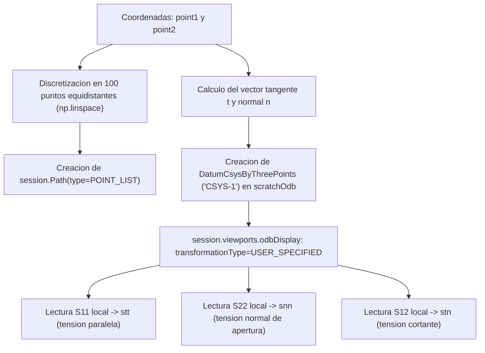

# 02. Extraccion de Tensiones y Criterio SC

Navegacion: [Portada Wiki](../index.md) > [03. Modulos](01-modulo-ffmcracking.md) > Extraccion de Tensiones y Criterio SC

================================================================================
1. DESCRIPCION DEL PROCESO
================================================================================

Para evaluar el Criterio Tensional (SC) en la probeta no fisurada, es necesario muestrear el tensor de tensiones local a lo largo de la linea donde nacera la grieta y proyectarlo en la direccion perpendicular a sus caras.

Este proceso se realiza mediante dos funciones concatenadas:
1. `extractStresses_crackpath(session, odbObject, CrackFFM)`:
   Obtiene los extremos de la grieta desde el objeto `CrackFFM` y delega la lectura en `extractStressesBetween2points()`.
2. `extractStressesBetween2points(session, odbObject, point1, point2)`:
   Genera una ruta de puntos (`session.Path`), construye un sistema de coordenadas cartesiano local alineado con la grieta (`CSYS-1`) y extrae las componentes locales de tension.

Diagrama del procedimiento en texto:

  point1, point2 (Extremos del segmento)
        |
        v
  Discretizacion en 100 puntos equidistantes (np.linspace)
        |
        v
  Creacion del camino espacial: session.Path(type=POINT_LIST)
        |
        v
  Calculo del vector tangente (t) y normal (n)
        |
        v
  Construccion del sistema de coordenadas local 'CSYS-1' en scratchOdb
        |
        v
  Transformacion del tensor de tensiones al sistema local (transformationType=USER_SPECIFIED)
        |
        v
  Lectura de componentes mediante session.XYDataFromPath:
    - S11 local: tension tangencial paralela a la grieta (stt)
    - S22 local: tension normal de apertura perpendicular a la grieta (snn)
    - S12 local: tension tangencial de cortadura (stn)

Diagrama Mermaid:


================================================================================
2. SISTEMA DE COORDENADAS LOCAL Y PROYECCION TENSIONAL
================================================================================

Las grietas pueden orientarse en cualquier direccion arbitraria respecto a los ejes globales (X, Y). Para evaluar la apertura en Modo I, el criterio requiere la traccion normal perpendicular a la grieta:

1. Base ortonormal local:
   A partir de los puntos `point1` y `point2`, se determinan los vectores unitarios:
   - Vector tangente unitario:
     t_vector = (p2 - p1) / ||p2 - p1||
   - Vector normal unitario:
     n_vector = (-t_y, t_x, 0.0)

2. Sistema 'CSYS-1':
   En la base de datos de sesion `scratchOdb`, Abaqus crea un sistema de coordenadas cartesiano local definido por tres puntos: el origen (`point1`), un punto en el eje local 1 (`point2`) y un punto auxiliar en el plano director normal.

3. Extraccion en Viewport:
   Al fijar `transformationType=USER_SPECIFIED` apuntando a `CSYS-1`, las salidas de campo proyectan directamente:
   - S11: Tension normal al plano local 1 (paralela a la fisura).
   - S22: Tension normal al plano local 2 (sigma_nn, responsable directa de la apertura en Modo I).
   - S12: Tension tangencial en el plano local (sigma_tn, cortadura pura sobre las caras).

================================================================================
3. EVALUACION DEL CRITERIO TENSIONAL: evaluate_stress_criterion
================================================================================

La funcion `evaluate_stress_criterion(stresses, sigmac)` recibe la coleccion de tensiones extraidas y la resistencia admisible a traccion `sigmac`.

Logica matematica implementada:
1. Filtra la serie temporal correspondiente al paso de carga de interes.
2. Identifica la componente de tension normal `snn` (S22 local).
3. Evalua el multiplicador critico puntual:

   t_SC = sigmac / min(snn)

Observacion critica sobre la implementacion actual:
En el codigo original, existe la siguiente comprobacion:
```python
if np.max(snn) > 0:
    k_sc = sigmac / np.min(snn)
```
Nota tecnica para desarrollo y depuracion:
Comprobar `max(snn) > 0` garantiza que exista alguna traccion en el trayecto, pero si la grieta se extiende hacia una zona que entra en compresion antes de terminar, `min(snn)` sera un numero negativo, lo que resultaria en un factor `t_SC` negativo no fisico. La condicion rigurosa para que el criterio puntual de Leguillon sea valido exige que `min(snn) > 0` a lo largo de todo el camino evaluado. Si `min(snn) <= 0`, la grieta sobrepasa la zona traccionada y la iniciacion puntual pura en Modo I no puede alcanzarse en esa longitud.

================================================================================
Navegacion: [Anterior: Modulo FFMcracking](01-modulo-ffmcracking.md) | [Portada Wiki](../index.md) | [Siguiente: Modelado XFEM y Criterio de Energia](03-metodo-xfem-y-energia.md)
================================================================================
