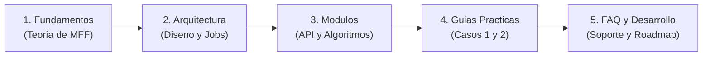

# Wiki de FFMcracking — Documentacion Tecnica

Framework computacional para la prediccion del inicio de grietas en Abaqus CAE mediante el Criterio Acoplado de la Mecanica de la Fractura Finita (Leguillon, 2002; Garcia, 2014) y Optimizacion Bayesiana.

================================================================================
1. MAPA DE NAVEGACION DE LA WIKI
================================================================================

La documentacion esta estructurada de forma modular para guiar tanto a usuarios que ejecutan simulaciones como a ingenieros e investigadores que desarrollan o amplian el framework:

Flujo de lectura recomendado:
  [1. Fundamentos] ---> [2. Arquitectura] ---> [3. Modulos] ---> [4. Guias Practicas] ---> [5. FAQ y Desarrollo]

Diagrama conceptual:

================================================================================
2. ESTRUCTURA TEMATICA Y CONTENIDOS
================================================================================

2.1. FUNDAMENTOS TEORICOS (wiki/es/01-fundamentos/)
--------------------------------------------------------------------------------
- 01. Vision General y Motivacion (01-introduccion.md)
  Limitaciones de los criterios clasicos de tension y de la Mecanica de la Fractura Elastica Lineal (MFEL). Superacion de las paradojas en concentradores mediante la hipotesis de salto finito.
- 02. Mecanica de Fractura Finita y Criterio Acoplado (02-mecanica-fractura-finita.md)
  Formulacion matematica completa del Criterio Acoplado (CA): Criterio de Tension (SC), Criterio de Energia (EC) mediante el Teorema del Trabajo Reciproco de Betti, acoplamiento min-max y determinacion de la longitud critica lc.

2.2. ARQUITECTURA DEL SISTEMA (wiki/es/02-arquitectura/)
--------------------------------------------------------------------------------
- 01. Diseno General del Sistema (01-diseno-general.md)
  Estructura por capas: Capa de Aplicacion, Capa de Optimizacion Bayesiana, Capa de Solver FFM y Kernel de Abaqus CAE.
- 02. Ciclo de Simulacion en Abaqus (02-ciclo-de-simulacion.md)
  Ciclo de vida dual de calculo: simulacion elastica continua (-without.odb), insercion cinematica de grieta con XFEM (-with.odb) y politica de cache del modelo base.

2.3. REFERENCIA TECNICA DE MODULOS (wiki/es/03-modulos/)
--------------------------------------------------------------------------------
- 01. Modulo Central FFMcracking (01-modulo-ffmcracking.md)
  Clases de datos (FFM_Material, FFM_Crack, FFM_InputModel), funcion orquestadora Compute_crit_factor_FFM y gestion de ficheros de trabajo.
- 02. Extraccion de Tensiones y Criterio SC (02-extraccion-tensiones.md)
  Discretizacion espacial sobre caminos de grieta (Path), transformacion a sistemas locales ortogonales (CSYS-1), proyeccion del tensor de tensiones y evaluacion puntual de k_SC.
- 03. Modelado XFEM y Criterio de Energia (03-metodo-xfem-y-energia.md)
  Uso de XFEM como separador geometrico no cohesivo, evaluacion del trabajo reciproco RE (Betti) y de la energia disipada DE = Gc * lc.
- 04. Modulo de Optimizacion Bayesiana (04-modulo-optimizacion.md)
  Regresion por Procesos Gaussianos (GPR), kernel RBF, funcion de adquisicion Expected Improvement (EI) y resolucion sin dependencias externas.

2.4. GUIAS PRACTICAS Y EJEMPLOS (wiki/es/04-guias-y-ejemplos/)
--------------------------------------------------------------------------------
- 01. Requisitos e Instalacion (01-requisitos-e-instalacion.md)
  Requisitos de entorno Abaqus (2020+), configuracion de PYTHONPATH y preparacion de carpetas de ejecucion.
- 02. Ejemplo 1: Grieta Fija (02-ejemplo-1-grieta-fija.md)
  Calculo directo del factor de carga critico para una grieta de longitud y posicion prefijadas en placa con taladro (sample1).
- 03. Ejemplo 2: Optimizacion de Longitud (03-ejemplo-2-optimizacion-longitud.md)
  Búsqueda automatica de la longitud critica de iniciacion lc y carga de rotura mediante optimizacion Bayesiana (sample2).

2.5. SOPORTE, FAQ Y DESARROLLO (wiki/es/05-faq-y-desarrollo/)
--------------------------------------------------------------------------------
- 01. FAQ y Resolucion de Problemas (01-resolucion-problemas-faq.md)
  Gestion de archivos bloqueados (.lck), convergencia numerica, inconsistencias de signo en tensiones y depuracion en Abaqus.
- 02. Guia para Desarrolladores y Hoja de Ruta (02-guia-desarrollo-y-extensiones.md)
  Estandares de codigo, compatibilidad Python 2/3, extensiones a modo mixto y formulacion para materiales compuestos e interfaces.

================================================================================
> [NOTA]
> Si es tu primera vez utilizando FFMcracking, se aconseja comenzar por
> 01-fundamentos/01-introduccion.md para comprender la fisica del problema,
> y continuar con 04-guias-y-ejemplos/01-requisitos-e-instalacion.md.
================================================================================
